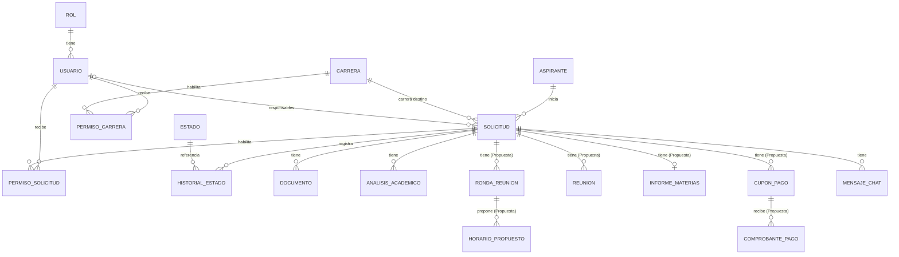

# USAL E3 - Contrato de la API REST (a implementar)

## Control de versiones

| Versión | Fecha | Autor | Descripción |
|---------|-------|-------|-------------|
| 1.0 | 2026-10-14 | jumaluc | Versión inicial: convenciones, entidades, endpoints por módulo y acciones del trámite, basada en requisitos v12.0 |

> El stack, los puertos y las convenciones de git están en el [README de la raíz](../README.md). El backend todavía no existe: este documento es el contrato a acordar con el equipo de backend.

Este documento fija el contrato entre el frontend (React, `services/api/client.ts`) y el backend (Spring Boot, a implementar) del sistema E3. Se basa en los Requisitos v12.0 (20 estados, 26 transiciones). Donde los requisitos no definen algo, la decisión figura como **Propuesta** y hay que validarla con backend.

## 1. Convenciones generales

| Tema | Definición |
| --- | --- |
| Base URL | Context path `/api` del backend (valor de `VITE_API_URL`; puertos en el [README](../README.md)). Todas las rutas de este documento son relativas a esa base. |
| Formato | JSON UTF-8. Archivos por `multipart/form-data`. Descargas binarias con `Content-Disposition: attachment`. |
| Nombres de campos | camelCase en JSON (default de Jackson). **Propuesta:** alinear `types/estado.ts` (`es_terminal` → `esTerminal`). |
| Fechas | ISO 8601 con zona: `2026-10-14T15:30:00-03:00`. Solo fecha: `2026-10-14`. |
| Identificadores | `id` numérico en las rutas. `codigoExp` (`EXP-2026-001`) solo para mostrar y buscar. |
| Estados | Siempre por `codigo` (`DOC-REV`), nunca por nombre (RF-ESTADO-004). |
| Sesión | Cookie `HttpOnly`, `Secure`, `SameSite=Lax` emitida por el backend; el cliente ya envía `credentials: 'include'`. Pendiente de confirmar (ARQUITECTURA, "Cómo habla con Backend"). |
| CORS | Origen `http://localhost:5173` con `Access-Control-Allow-Credentials: true`. |
| CSRF | **Propuesta:** cookie `XSRF-TOKEN` + header `X-XSRF-TOKEN` en POST, PUT, PATCH y DELETE. Requiere agregar el header en `client.ts`. |
| Paginación | `?page=0&size=20&sort=campo,desc`. Respuesta con la forma `Page<T>` (abajo). |
| Doble verificación | Es solo de UI (RF-AUTH-006): el backend recibe una única llamada, al confirmar. |
| Acciones disponibles | El detalle de una solicitud trae `accionesDisponibles`, calculadas por el backend según rol, permiso (participante u observador) y estado. El frontend solo muestra los botones de esa lista (frontend-interfaces §0.10 y §0.16). |
| Concurrencia | Toda acción que cambia el estado envía `estadoEsperado`. Si la solicitud ya cambió, el backend responde 409 `TRANSICION_INVALIDA` (frontend-interfaces §0.16.4). |

### Respuesta paginada

```json
{
  "content": [],
  "page": 0,
  "size": 20,
  "totalElements": 134,
  "totalPages": 7
}
```

### Formato de error

Compatible con `ApiErrorBody` (`message`, `errors`) de `types/api.ts`; suma `status`, `code`, `timestamp` y `path`.

```json
{
  "status": 409,
  "code": "TRANSICION_INVALIDA",
  "message": "Esta acción ya no está disponible porque el estado de la solicitud cambió.",
  "errors": { "comentario": ["Es obligatorio"] },
  "timestamp": "2026-10-14T15:30:00-03:00",
  "path": "/api/solicitudes/42/documentacion/rechazar"
}
```

### Códigos HTTP

| Código | Cuándo | `ApiErrorKind` en el front |
| --- | --- | --- |
| 200 | Lectura o acción que devuelve cuerpo | — |
| 201 | Recurso creado (con header `Location`) | — |
| 204 | Acción sin cuerpo de respuesta | — |
| 400 | Validación de campos (`errors` por campo) | `bad_request` |
| 401 | Sin sesión o sesión vencida | `unauthorized` |
| 403 | Rol sin permiso, u observador intentando actuar | `forbidden` |
| 404 | Recurso inexistente o no visible para el usuario | `not_found` |
| 409 | Transición inválida, proceso ya tomado, email o DNI duplicado | hoy `unknown`: agregar `conflict` |
| 413 | Archivo de más de 10 MB o total de más de 50 MB | hoy `unknown`: mapear a `bad_request` |
| 423 | Cuenta bloqueada (el cuerpo trae `bloqueadoHasta`) | hoy `unknown`: agregar `locked` |
| 500 | Error del servidor | `server` |

### Códigos de negocio (`code`)

| `code` | HTTP | Significado |
| --- | --- | --- |
| `VALIDACION` | 400 | Uno o más campos inválidos; detalle en `errors` |
| `DUPLICADO` | 409 | Email, DNI o código de carrera ya existente |
| `CREDENCIALES_INVALIDAS` | 401 | Email o contraseña incorrectos; el cuerpo trae `intentosRestantes` |
| `CUENTA_BLOQUEADA` | 423 | 3 intentos fallidos: bloqueo de 6 h (login) o 15 min (código) |
| `EMAIL_NO_VALIDADO` | 403 | El aspirante no validó el código de 6 dígitos |
| `CODIGO_INVALIDO` / `CODIGO_EXPIRADO` | 400 | Código de validación o de recupero incorrecto o vencido (10 min) |
| `USUARIO_NO_REGISTRADO` | 403 | Login Google con email fuera de `usal.edu.ar`, inexistente o inactivo |
| `TRANSICION_INVALIDA` | 409 | La acción no corresponde al estado actual |
| `NO_PARTICIPANTE` | 403 | El usuario es observador en esa solicitud (RF-AUTH-005) |
| `PROCESO_YA_TOMADO` | 409 | Otro usuario tomó el proceso antes |
| `UNICO_RESPONSABLE` | 409 | No puede darse de baja: es el único con acceso (RF-PROC-004) |
| `PROCESO_ACTIVO` | 409 | Revocación de permiso con proceso activo sin `forzar` (RF-ADMIN-004) |
| `SIN_PERMISO_CARRERA` | 409 | Asignación manual a un usuario sin permiso y sin pedir permiso temporal |
| `CHAT_DESHABILITADO` | 403 | La solicitud todavía no tiene responsable (RF-MSG-001) |
| `ARCHIVO_INVALIDO` | 400 | Formato distinto de PDF o JPG |
| `LIMITE_TAMANO` | 413 | Supera 10 MB por archivo o 50 MB en total |
| `DOCUMENTO_BLOQUEADO` | 409 | Se intenta reemplazar un documento marcado ✅ |
| `MARCAS_INCOMPLETAS` | 409 | Rechazo sin al menos un ❌ o con documentos en `PENDIENTE` (RF-ACAD-009) |

## 2. Entidades

Son 22 entidades: 13 salen de los Requisitos v12 y 9 son **Propuesta** para cubrir datos que el frontend necesita y que los requisitos todavía no modelan. Los campos van en camelCase, como viajan en el JSON; en la base se guardan en snake\_case.

Hay dos tablas de personas: `usuarios` (personal @usal y Admin) y `aspirantes`. Por eso las referencias a "quién hizo algo" en chat, notificaciones y sesiones usan el par `tipo` + `id` (`USUARIO` o `ASPIRANTE`).

### 2.1 Rol (`roles`)

| Campo | Tipo | Notas |
| --- | --- | --- |
| id | int | PK |
| codigo | string | `ASPIRANTE`, `ACAD`, `SECRE`, `ADMIN`, `REVISOR`. El front lo mapea a `constants/roles.ts` |
| nombre | string |  |
| descripcion | string |  |
| activo | boolean |  |

Observador no es un rol: es un Académico o Secretaría sin permiso de proceso sobre esa solicitud.

### 2.2 Usuario (`usuarios`)

Personal @usal (Académico, Secretaría, Revisor) y Admin General.

| Campo | Tipo | Notas |
| --- | --- | --- |
| id | int | PK |
| email | string | Único. Dominio `usal.edu.ar` |
| nombre | string |  |
| rolId | int | FK a `roles` |
| activo | boolean | Default `true` |
| intentosLoginFallidos | int | Solo aplica al Admin (login con contraseña) |
| bloqueadoHasta | datetime? |  |
| fechaCreacion | datetime |  |
| fechaUltimoLogin | datetime? |  |
| telefono | string? | **Propuesta** (RF-AUTH-007) |
| avatar | string? | **Propuesta**: clave del avatar elegido (galería por género) |
| googleSub | string? | **Propuesta**: `sub` de Google, se completa en el primer login |
| passwordHash | string? | **Propuesta**: solo Admin. Nunca se expone |

### 2.3 Aspirante (`aspirantes`)

| Campo | Tipo | Notas |
| --- | --- | --- |
| id | int | PK |
| email | string | Único |
| passwordHash | string | Nunca se expone |
| nombre | string |  |
| telefono | string |  |
| dni | string | Único |
| emailValidado | boolean | Sin validar no puede crear solicitudes |
| intentosLoginFallidos | int | 3 fallidos → bloqueo 6 h |
| bloqueadoHasta | datetime? |  |
| activo | boolean |  |
| fechaCreacion | datetime |  |
| fechaUltimoLogin | datetime? |  |
| avatar | string? | **Propuesta** |

Los campos `codigoValidacion`, `fechaValidacionEnviada` y `expiracionCodigo` de los requisitos se mueven a `CodigoVerificacion` (2.19) para cubrir también el recupero de contraseña.

### 2.4 Carrera (`carreras`)

| Campo | Tipo | Notas |
| --- | --- | --- |
| id | int | PK |
| codigo | string | Único, ej. `ING-INF-001`. El formulario inicial envía este código |
| nombre | string |  |
| facultad | string |  |
| descripcion | string |  |
| activo | boolean | Baja lógica |
| fechaCreacion | datetime |  |

### 2.5 Estado (`estados`)

| Campo | Tipo | Notas |
| --- | --- | --- |
| id | int | PK |
| codigo | string | Único: los 20 códigos de RF-ESTADO-001 |
| nombre | string | Solo para mostrar |
| descripcion | string |  |
| esTerminal | boolean | Hoy solo `INSC-RECH` |
| activo | boolean |  |

### 2.6 Solicitud (`solicitudes`)

| Campo | Tipo | Notas |
| --- | --- | --- |
| id | int | PK |
| codigoExp | string | Único, `EXP-2026-001` |
| aspiranteId | int | FK |
| carreraDestinoId | int | FK |
| estadoCodigo | string | **Propuesta**: estado actual desnormalizado, para filtrar la bandeja sin recorrer el historial |
| responsableAcademicoId | int? | FK a `usuarios` |
| responsableAdministrativoId | int? | FK a `usuarios` |
| fechaCreacion | datetime |  |
| fechaUltimaMod | datetime |  |
| fechaUltimoCambioEstado | datetime |  |
| fechaAsignacionAcademico | datetime? |  |
| fechaAsignacionAdministrativo | datetime? |  |
| universidadOrigen | string | **Propuesta** (Anexo A #1 de interfaces) |
| facultadOrigen | string | **Propuesta** |
| carreraOrigen | string | **Propuesta** |
| condicionAcademica | string | **Propuesta**; valores a definir (Anexo A #2) |
| observaciones | string? | **Propuesta** |
| documentosLegalizados | boolean? | **Propuesta**: respuesta del aspirante en `INSC-ACEP` |

### 2.7 Historial de estado (`estados_solicitud`)

| Campo | Tipo | Notas |
| --- | --- | --- |
| id | int | PK |
| solicitudId | int | FK |
| estadoCodigo | string | FK a `estados.codigo` |
| estadoAnteriorCodigo | string? | Nulo en la creación |
| fechaAsignacion | datetime | Orden DESC en el timeline |
| fechaUltimaModificacion | datetime |  |
| usuarioUltimoCambioId | int? | Nulo si el cambio lo disparó el aspirante |
| comentarios | string? | Motivo de rechazo, etc. |

### 2.8 Documento de solicitud (`documentos_solicitud`)

| Campo | Tipo | Notas |
| --- | --- | --- |
| id | int | PK |
| solicitudId | int | FK |
| tipo | string | `ANALITICO`, `PLAN`, `PROGRAMA`, `OTRO` |
| descripcion | string? | **Propuesta**: ej. "Programa de Análisis Matemático II" |
| nombreArchivo | string? | Nulo si es un requerido faltante |
| rutaArchivo | string? | Por año y DNI. Nunca se expone; se descarga por endpoint |
| tamanoBytes | int? |  |
| fechaCarga | datetime? |  |
| version | int | Default 1 |
| reemplazaAId | int? | Versión anterior (no se borra) |
| estadoRevision | enum | `PENDIENTE`, `OK`, `RECARGAR` |
| etapaRevision | enum | `DOCUMENTACION`, `LEGALIZACION` |
| comentarioRevision | string? | Visible para el aspirante |
| revisadoPorId | int? |  |
| fechaRevision | datetime? |  |
| esRequeridoFaltante | boolean | Agregado por el Académico, sin archivo |

**Propuesta:** campo `borrador` (boolean), `true` mientras el aspirante subió el archivo pero todavía no ejecutó `ENVIAR_DOCUMENTACION` (Anexo A #4 de interfaces).

### 2.9 Análisis académico (`analisis_academico`)

| Campo | Tipo | Notas |
| --- | --- | --- |
| id | int | PK |
| solicitudId | int | FK |
| tipo | enum | `MATRIZ_EQUIVALENCIAS`, `HORARIO_CURSADA` |
| version | int | La API expone solo la vigente (mayor versión) |
| reemplazaAId | int? |  |
| nombreArchivo | string? | Archivo, notas o ambos |
| rutaArchivo | string? |  |
| notas | string? |  |
| fechaCarga | datetime |  |
| subidoPorId | int |  |

### 2.10 Ronda de reunión (`rondas_reunion`) — Propuesta

Los requisitos definen las rondas como estados (`REU-FEC-ASP-1` y `-2`) pero no dónde se guardan las fechas propuestas.

| Campo | Tipo | Notas |
| --- | --- | --- |
| id | int | PK |
| solicitudId | int | FK |
| numero | int | 1 o 2 |
| propuestaPorId | int | Académico |
| fechaPropuesta | datetime |  |
| motivoOtrasFechas | string? | Lo que escribe el aspirante al pedir otras fechas (solo ronda 1) |
| disponibilidadAspirante | string? | Cuándo puede reunirse |
| rechazada | boolean | Ronda 2 rechazada → `REU-CHAT` |

### 2.11 Horario propuesto (`horarios_propuestos`) — Propuesta

| Campo | Tipo | Notas |
| --- | --- | --- |
| id | int | PK |
| rondaId | int | FK. Hasta 7 por ronda |
| inicio | datetime | Franja 10:00 a 18:00, dentro de 14 a 30 días |
| fin | datetime | inicio + 1 h |
| elegido | boolean | Uno solo por solicitud |

### 2.12 Reunión (`reuniones`) — Propuesta

| Campo | Tipo | Notas |
| --- | --- | --- |
| id | int | PK |
| solicitudId | int | FK. Una vigente por solicitud; una nueva si el aspirante no se presentó |
| inicio | datetime |  |
| fin | datetime |  |
| origen | enum | `ELEGIDA_ASPIRANTE`, `FIJADA_CHAT` |
| horarioPropuestoId | int? | Si la eligió el aspirante |
| enlaceMeet | string? | Lo carga el Académico en `REU-PEND` |
| notas | string? | Notas de reunión (RF-ACAD-004) |
| resultado | enum | `PENDIENTE`, `REALIZADA`, `NO_ASISTIO` |
| fechaResultado | datetime? |  |

### 2.13 Informe de materias (`informes_materias`) — Propuesta

RF-ASP-006 pide una tabla estructurada, pero la matriz hoy es archivo o notas (Anexo A #8 de interfaces).

| Campo | Tipo | Notas |
| --- | --- | --- |
| id | int | PK |
| solicitudId | int | FK, único |
| cantidadMateriasAdeudar | int |  |
| montoAPagar | decimal | ARS |
| observaciones | string? |  |
| items | lista | `materiaDestino`, `materiaOrigen`, `cargaHoraria`, `correlativas`, `reconocida` |

### 2.14 Cupón de pago (`cupones_pago`) — Propuesta

| Campo | Tipo | Notas |
| --- | --- | --- |
| id | int | PK |
| solicitudId | int | FK |
| monto | decimal | Prellenado según política; solo lectura (Anexo A #14) |
| rutaArchivo | string | PDF generado por el sistema |
| fechaEmision | datetime |  |
| emitidoPorId | int | Secretaría |

### 2.15 Comprobante de pago (`comprobantes_pago`) — Propuesta

| Campo | Tipo | Notas |
| --- | --- | --- |
| id | int | PK |
| solicitudId | int | FK |
| cuponId | int | FK |
| version | int | Cada reenvío suma 1; los anteriores se conservan |
| nombreArchivo | string | PDF o JPG, máx. 10 MB |
| rutaArchivo | string |  |
| tamanoBytes | int |  |
| fechaCarga | datetime |  |
| estadoVerificacion | enum | `PENDIENTE`, `ACEPTADO`, `RECHAZADO` |
| comentarioSecretaria | string? | Obligatorio si se rechaza |
| verificadoPorId | int? |  |
| fechaVerificacion | datetime? |  |

### 2.16 Mensaje de chat (`mensajes_chat`)

| Campo | Tipo | Notas |
| --- | --- | --- |
| id | int | PK |
| solicitudId | int | FK. El chat es de la solicitud, no del usuario |
| autorTipo | enum | `USUARIO`, `ASPIRANTE` |
| autorId | int |  |
| contenido | string | Máx. 500 caracteres |
| tipoConsulta | enum | `DOCUMENTACION`, `ESTADO`, `CALCULOS`, `FECHAS`, `OTRO` |
| adjuntoNombre | string? | Máx. 5 MB |
| adjuntoRuta | string? |  |
| fechaEnvio | datetime |  |

**Propuesta:** el indicador "visto" se guarda en `lecturas_mensaje` (`mensajeId`, `lectorTipo`, `lectorId`, `fechaLectura`), porque hay hasta tres lectores por chat.

### 2.17 Permiso por carrera (`user_career_permissions`)

| Campo | Tipo | Notas |
| --- | --- | --- |
| id | int | PK |
| userId | int | FK a `usuarios` |
| careerId | int | FK a `carreras`. Único con `userId` |
| assignedAt | datetime |  |
| revokedAt | datetime? | Nulo = activo. Toda validación exige `revokedAt IS NULL` |

### 2.18 Permiso por solicitud (`user_solicitud_permissions`)

| Campo | Tipo | Notas |
| --- | --- | --- |
| id | int | PK |
| userId | int | FK |
| solicitudId | int | FK. Único con `userId` |
| assignedAt | datetime |  |
| assignedBy | int | Admin que lo creó |
| expiresAt | datetime? | Nulo = sin vencimiento |
| revokedAt | datetime? | Nulo = activo |

### 2.19 Código de verificación (`codigos_verificacion`) — Propuesta

| Campo | Tipo | Notas |
| --- | --- | --- |
| id | int | PK |
| aspiranteId | int | FK |
| proposito | enum | `VALIDACION_EMAIL`, `RECUPERO_PASSWORD` |
| codigoHash | string | 6 dígitos, guardado con hash |
| expiraEn | datetime | Creación + 10 min |
| intentos | int | 3 fallidos → bloqueo 15 min |
| usadoEn | datetime? |  |

### 2.20 Sesión (`sesiones`) — Propuesta

Alimenta "Historial de accesos" y "Sesiones activas" de Mi perfil (RF-AUTH-007).

| Campo | Tipo | Notas |
| --- | --- | --- |
| id | string | UUID; es el valor de la cookie |
| titularTipo | enum | `USUARIO`, `ASPIRANTE` |
| titularId | int |  |
| ip | string |  |
| userAgent | string |  |
| inicio | datetime |  |
| ultimoUso | datetime |  |
| expiraEn | datetime | 30 días con "recuérdame", 1 día Admin |
| cerradaEn | datetime? |  |

### 2.21 Notificación (`notificaciones`) — Propuesta

La campana de la barra superior replica los mails (interfaces §4.9).

| Campo | Tipo | Notas |
| --- | --- | --- |
| id | int | PK |
| destinatarioTipo | enum | `USUARIO`, `ASPIRANTE` |
| destinatarioId | int |  |
| solicitudId | int? | Destino del link |
| tipo | string | ej. `CAMBIO_ESTADO`, `PROCESO_TOMADO`, `PERMISO_ASIGNADO` |
| titulo | string |  |
| mensaje | string |  |
| leida | boolean |  |
| fechaCreacion | datetime |  |

### 2.22 Auditoría (`auditoria_sistema`)

| Campo | Tipo | Notas |
| --- | --- | --- |
| id | int | PK |
| timestamp | datetime | Con zona |
| usuarioId | int? |  |
| usuarioEmail | string |  |
| accion | string | `cambio_estado`, `tomar_proceso`, `baja_responsable`, `marca_documento`, `login`, `descarga_expediente`… |
| entidad | string | `solicitud`, `usuario`, `carrera`, `permiso`… |
| entidadId | int |  |
| estadoCodigoAnterior | string? | Siempre código, nunca nombre |
| estadoCodigoNuevo | string? |  |
| detalles | JSON |  |
| comentarios | string? |  |
| ipOrigen | string |  |

## 3. Relaciones entre entidades



Fuera del diagrama: Sesión, Código de verificación, Notificación y Auditoría.

La solicitud es el centro: el aspirante la inicia, la carrera destino define quién puede participar y todas las tablas del trámite (de la columna derecha) tienen `solicitudId`. El personal llega a una solicitud por permiso de carrera o por permiso temporal.

## 4. Autenticación y perfil

Hay tres formas de entrar: aspirante con email y contraseña, personal @usal con Google y Admin con usuario y contraseña. Las tres terminan igual: el backend setea la cookie de sesión y el front llama a `GET /auth/me`.

### 4.1 Endpoints de autenticación

| Método | Ruta | Quién | Qué hace | Respuesta | Requisito |
| --- | --- | --- | --- | --- | --- |
| POST | `/auth/registro` | Público | Crea el aspirante y envía el código de 6 dígitos | 201 `{ aspiranteId, email }` | RF-AUTH-001 |
| POST | `/auth/registro/validar` | Público | Valida el código e inicia sesión | 200 `Sesion` + cookie | RF-AUTH-001 |
| POST | `/auth/registro/reenviar-codigo` | Público | Genera un código nuevo (invalida el anterior) | 204 | RF-AUTH-001 |
| POST | `/auth/login` | Aspirante | Login con email y contraseña | 200 `Sesion` + cookie | RF-AUTH-002 |
| GET | `/auth/google` | Personal @usal | Redirige a Google | 302 | RF-AUTH-003 |
| GET | `/auth/google/callback` | Google | Valida dominio y alta; crea sesión | 302 a `/dashboard` o a `/login?error=USUARIO_NO_REGISTRADO` | RF-AUTH-003 |
| POST | `/auth/admin/login` | Admin | Login con usuario y contraseña | 200 `Sesion` + cookie | RF-AUTH-004 |
| POST | `/auth/password/recuperar` | Aspirante | Envía código de recupero | 204 siempre (no revela si el email existe) | RF-AUTH-002 |
| POST | `/auth/password/restablecer` | Aspirante | Cambia la contraseña con el código | 204 | RF-AUTH-002 |
| POST | `/auth/logout` | Todos | Cierra la sesión actual | 204 | — |
| GET | `/auth/me` | Todos | Datos de la sesión | 200 `Sesion` | — |

**`POST /auth/registro`** — request

```json
{
  "email": "juan.perez@gmail.com",
  "password": "Clave#2026",
  "nombre": "Juan Pérez",
  "telefono": "+54 11 5555-0000",
  "dni": "40123456"
}
```

Validaciones: contraseña de 8 o más caracteres con mayúscula, número y carácter especial. Email o DNI repetido → 409 `DUPLICADO` con `errors.email` o `errors.dni`.

**`POST /auth/registro/validar`** — request `{ "email": "juan.perez@gmail.com", "codigo": "483920" }`. Errores: 400 `CODIGO_INVALIDO` (con `intentosRestantes`), 400 `CODIGO_EXPIRADO`, 423 `CUENTA_BLOQUEADA` (15 min).

**`POST /auth/login`** — request

```json
{ "email": "juan.perez@gmail.com", "password": "Clave#2026", "recordarme": true }
```

Errores: 401 `CREDENCIALES_INVALIDAS` `{ "intentosRestantes": 2 }`, 423 `CUENTA_BLOQUEADA` `{ "bloqueadoHasta": "2026-10-14T21:30:00-03:00" }`, 403 `EMAIL_NO_VALIDADO`.

**`POST /auth/admin/login`** — request `{ "usuario": "admin@usal.edu.ar", "password": "…" }`. Sesión de 1 día.

**`POST /auth/password/restablecer`** — request `{ "email", "codigo", "passwordNueva" }`.

**`Sesion`** — respuesta de login, validar y `GET /auth/me`

```json
{
  "tipo": "USUARIO",
  "id": 7,
  "nombre": "María Gómez",
  "email": "m.gomez@usal.edu.ar",
  "rol": "ACAD",
  "avatar": "hombre-02",
  "emailValidado": true,
  "esOAuth": true,
  "carrerasConPermiso": [
    { "id": 1, "codigo": "ING-INF-001", "nombre": "Ingeniería en Informática" }
  ],
  "expiraEn": "2026-11-13T15:30:00-03:00"
}
```

`tipo` es `ASPIRANTE` o `USUARIO`. `carrerasConPermiso` solo viene para Académico y Secretaría (permisos activos, `revokedAt` nulo); el front la usa para ordenar la bandeja y no para habilitar botones.

### 4.2 Endpoints de perfil (RF-AUTH-007)

| Método | Ruta | Quién | Qué hace | Respuesta |
| --- | --- | --- | --- | --- |
| GET | `/perfil` | Todos | Datos del perfil | 200 `Perfil` |
| PATCH | `/perfil` | Todos menos Revisor | Edita `nombre` (no OAuth), `telefono`, `avatar` | 200 `Perfil` |
| PUT | `/perfil/password` | Aspirante, Admin | `{ passwordActual, passwordNueva }` | 204 |
| PUT | `/perfil/email` | Admin | `{ emailNuevo, passwordActual }`; valida dominio `usal.edu.ar` | 204 |
| GET | `/perfil/accesos` | Todos | Últimos 10 logins: `[{ fecha, ip, duracionMinutos }]` | 200 |
| GET | `/perfil/sesiones` | Todos | Sesiones activas: `[{ id, ip, userAgent, inicio, ultimoUso, actual }]` | 200 |
| DELETE | `/perfil/sesiones/{sesionId}` | Todos | Cierra otra sesión | 204 |

**`Perfil`**

```json
{
  "nombre": "Juan Pérez",
  "email": "juan.perez@gmail.com",
  "telefono": "+54 11 5555-0000",
  "dni": "40123456",
  "avatar": "hombre-02",
  "rol": "ASPIRANTE",
  "esOAuth": false,
  "camposEditables": ["nombre", "telefono", "avatar"]
}
```

El catálogo de avatares vive en `frontend/src/assets/`; el backend solo guarda y valida la clave (`hombre-02`). Todos los cambios de perfil quedan en auditoría.

## 5. Catálogos: carreras, estados y roles

Los catálogos los carga el backend; el frontend nunca los hardcodea (interfaces §0.12).

| Método | Ruta | Quién | Qué hace | Respuesta | Requisito |
| --- | --- | --- | --- | --- | --- |
| GET | `/carreras` | Autenticado | Lista carreras. `?activo=true` por defecto; el Admin puede pedir `?activo=todas` | 200 `Carrera[]` | RF-ASP-001 |
| GET | `/carreras/{id}` | Autenticado | Detalle | 200 `Carrera` | — |
| POST | `/carreras` | Admin | Crea carrera | 201 `Carrera` | RF-ADMIN-002 |
| PUT | `/carreras/{id}` | Admin | Modifica datos | 200 `Carrera` | RF-ADMIN-002 |
| PATCH | `/carreras/{id}/activo` | Admin | `{ "activo": false }` (baja lógica) | 200 `Carrera` | RF-ADMIN-002 |
| GET | `/estados` | Autenticado | Catálogo de los 20 estados | 200 `Estado[]` | RF-ESTADO-003 |
| GET | `/roles` | Admin | Roles asignables a personal @usal | 200 `Rol[]` | RF-ADMIN-001 |

**`Carrera`**

```json
{
  "id": 1,
  "codigo": "ING-INF-001",
  "nombre": "Ingeniería en Informática",
  "facultad": "Facultad de Ingeniería",
  "descripcion": "…",
  "activo": true
}
```

Request de `POST` y `PUT`: los mismos campos sin `id` ni `activo`. `codigo` repetido → 409 `DUPLICADO`.

**`Estado`**

```json
{
  "codigo": "DOC-REV",
  "nombre": "Documentación pendiente de revisión",
  "descripcion": "El aspirante envió la documentación y espera la revisión del Académico",
  "esTerminal": false,
  "activo": true
}
```

El front puede cachear `/estados` durante la sesión: cambia solo con una nueva versión de requisitos.

## 6. Solicitudes: lectura, creación y documentos

Un mismo recurso `/solicitudes` sirve a todos los roles: el backend filtra según quién pregunta. El aspirante solo ve las suyas; el personal ve todas (acceso básico) y actúa solo donde es participante.

### 6.1 Endpoints

| Método | Ruta | Quién | Qué hace | Respuesta | Requisito |
| --- | --- | --- | --- | --- | --- |
| GET | `/solicitudes` | Todos | Listado o bandeja con filtros | 200 `Page<SolicitudResumen>` | RF-PROC-001 |
| POST | `/solicitudes` | Aspirante validado | Crea la solicitud en `SOL-INI` | 201 `SolicitudDetalle` | RF-ASP-001 |
| GET | `/solicitudes/{id}` | Dueño o personal | Detalle con `accionesDisponibles` | 200 `SolicitudDetalle` | RF-ASP-003, RF-PROC-002 |
| GET | `/solicitudes/{id}/historial` | Dueño o personal | Timeline de estados y responsables, DESC | 200 `EventoHistorial[]` | RF-AUDIT-002 |
| GET | `/solicitudes/{id}/documentos` | Dueño o personal | Documentos vigentes; `?versiones=true` suma las anteriores | 200 `Documento[]` | RF-ACAD-009 |
| POST | `/solicitudes/{id}/documentos` | Aspirante | Sube un archivo (borrador hasta enviar) | 201 `Documento` | RF-ASP-002, 004, 009 |
| DELETE | `/solicitudes/{id}/documentos/{docId}` | Aspirante | Quita un borrador no enviado | 204 | RF-ASP-002 |
| GET | `/solicitudes/{id}/documentos/{docId}/archivo` | Dueño o personal | Descarga el archivo | 200 binario | RF-PROC-002 |
| GET | `/solicitudes/{id}/analisis` | Dueño o personal | Matriz y horario vigentes (nunca versiones viejas) | 200 `Analisis[]` | RF-ACAD-002 |
| GET | `/solicitudes/{id}/analisis/{analisisId}/archivo` | Dueño o personal | Descarga | 200 binario | RF-ACAD-002 |
| GET | `/solicitudes/{id}/reunion` | Dueño o personal | Rondas, horarios propuestos y reunión vigente | 200 `ReunionInfo` | RF-ASP-005 |
| GET | `/solicitudes/{id}/informe` | Dueño o personal | Informe de materias, desde `CUPON-SOL` | 200 `Informe` | RF-ASP-006 |
| GET | `/solicitudes/{id}/pago` | Dueño o personal | Cupón y comprobantes | 200 `Pago` | RF-ASP-007, RF-SEC-002 |
| GET | `/solicitudes/{id}/pago/cupon/archivo` | Dueño o personal | PDF del cupón | 200 binario | RF-ASP-007 |
| GET | `/solicitudes/{id}/pago/comprobantes/{compId}/archivo` | Dueño o personal | Comprobante | 200 binario | RF-SEC-002 |

### 6.2 Listado y bandeja

Filtros de `GET /solicitudes`: `estado` (código, repetible), `carreraId`, `desde` y `hasta` (última actualización), `q` (busca en `codigoExp`, nombre del aspirante y carrera), `asignadas=true` ("Mis asignadas"), `finalizadas=true|false`.

El orden por defecto lo resuelve el backend: primero las carreras con permiso del usuario, agrupadas, y después el resto alfabético por carrera (RF-PROC-001). Para el aspirante: primero las que requieren su acción, después por última actualización.

**`SolicitudResumen`**

```json
{
  "id": 42,
  "codigoExp": "EXP-2026-001",
  "aspirante": { "id": 15, "nombre": "Juan Pérez" },
  "universidadOrigen": "Universidad Nacional de La Plata",
  "carreraDestino": { "id": 1, "codigo": "ING-INF-001", "nombre": "Ingeniería en Informática" },
  "estado": { "codigo": "DOC-REV", "nombre": "Documentación pendiente de revisión" },
  "responsableAcademico": null,
  "responsableAdministrativo": null,
  "fechaUltimaMod": "2026-10-14T15:30:00-03:00",
  "requiereMiAccion": true,
  "esDeMisCarreras": true
}
```

### 6.3 Crear solicitud

**`POST /solicitudes`** — request

```json
{
  "universidadOrigen": "Universidad Nacional de La Plata",
  "facultadOrigen": "Facultad de Informática",
  "carreraOrigen": "Licenciatura en Sistemas",
  "carreraDestinoCodigo": "ING-INF-001",
  "condicionAcademica": "REGULAR",
  "observaciones": ""
}
```

Los datos personales no se envían: salen de la cuenta. El backend genera `codigoExp`, deja la solicitud en `SOL-INI` sin responsable y notifica a quienes tienen permiso sobre la carrera. Errores: 403 `EMAIL_NO_VALIDADO`, 400 `VALIDACION` (carrera inexistente o inactiva).

### 6.4 Detalle

**`SolicitudDetalle`**

```json
{
  "id": 42,
  "codigoExp": "EXP-2026-001",
  "estado": { "codigo": "DOC-RECH", "nombre": "Documentación rechazada", "esTerminal": false },
  "aspirante": { "id": 15, "nombre": "Juan Pérez", "email": "juan.perez@gmail.com", "telefono": "+54 11 5555-0000", "dni": "40123456" },
  "datosOrigen": {
    "universidad": "Universidad Nacional de La Plata",
    "facultad": "Facultad de Informática",
    "carrera": "Licenciatura en Sistemas",
    "condicionAcademica": "REGULAR",
    "observaciones": ""
  },
  "carreraDestino": { "id": 1, "codigo": "ING-INF-001", "nombre": "Ingeniería en Informática" },
  "responsableAcademico": { "id": 7, "nombre": "María Gómez", "email": "m.gomez@usal.edu.ar", "fechaAsignacion": "2026-10-10T09:00:00-03:00" },
  "responsableAdministrativo": null,
  "fechaCreacion": "2026-10-08T11:00:00-03:00",
  "fechaUltimaMod": "2026-10-14T15:30:00-03:00",
  "fechaUltimoCambioEstado": "2026-10-14T15:30:00-03:00",
  "miRelacion": "ASPIRANTE",
  "accionesDisponibles": ["ENVIAR_DOCUMENTACION"],
  "ultimaObservacion": { "comentario": "El analítico no está firmado", "usuario": "María Gómez", "fecha": "2026-10-14T15:30:00-03:00" },
  "resumenDocumentos": { "ok": 2, "recargar": 1, "pendiente": 0 },
  "chatHabilitado": true,
  "mensajesNoLeidos": 3
}
```

`miRelacion` vale `ASPIRANTE`, `PARTICIPANTE`, `OBSERVADOR`, `ADMIN` o `REVISOR`, y resuelve el modo de las interfaces (acción o solo lectura). `accionesDisponibles` usa los códigos de la sección 7.1.

**`EventoHistorial`**

```json
{
  "fecha": "2026-10-14T15:30:00-03:00",
  "tipo": "CAMBIO_ESTADO",
  "estadoAnterior": "DOC-REV",
  "estadoNuevo": "DOC-RECH",
  "usuario": "María Gómez",
  "comentario": "El analítico no está firmado"
}
```

`tipo`: `CAMBIO_ESTADO`, `CAMBIO_RESPONSABLE` o `DOCUMENTO_CARGADO`.

### 6.5 Documentos

**`POST /solicitudes/{id}/documentos`** — `multipart/form-data`

| Parte | Tipo | Obligatorio | Notas |
| --- | --- | --- | --- |
| `archivo` | file | Sí | PDF o JPG, máx. 10 MB; 50 MB entre todos los del envío |
| `tipo` | string | Sí | `ANALITICO`, `PLAN`, `PROGRAMA`, `OTRO` |
| `descripcion` | string | No | ej. "Programa de Física I" |
| `reemplazaAId` | int | En recargas | Documento marcado `RECARGAR` que se reemplaza |

Se acepta en `SOL-INI` (documentos nuevos) y en `DOC-RECH` y `LEG-RECH` (solo reemplazos de documentos `RECARGAR`). Cada archivo se sube al elegirlo y queda como borrador hasta `ENVIAR_DOCUMENTACION`. Errores: 400 `ARCHIVO_INVALIDO`, 413 `LIMITE_TAMANO`, 409 `DOCUMENTO_BLOQUEADO`, 409 `TRANSICION_INVALIDA`.

**`Documento`**

```json
{
  "id": 301,
  "tipo": "ANALITICO",
  "descripcion": null,
  "nombreArchivo": "analitico.pdf",
  "tamanoBytes": 1048576,
  "fechaCarga": "2026-10-12T10:00:00-03:00",
  "version": 2,
  "reemplazaAId": 120,
  "borrador": false,
  "estadoRevision": "PENDIENTE",
  "etapaRevision": "DOCUMENTACION",
  "comentarioRevision": null,
  "revisadoPor": null,
  "fechaRevision": null,
  "esRequeridoFaltante": false,
  "urlDescarga": "/solicitudes/42/documentos/301/archivo"
}
```

### 6.6 Otras respuestas de lectura

**`Analisis`** — una entrada por tipo, solo la vigente:

```json
{ "id": 88, "tipo": "MATRIZ_EQUIVALENCIAS", "version": 2, "nombreArchivo": "matriz.pdf", "notas": "Se reconocen 6 materias", "fechaCarga": "2026-10-20T12:00:00-03:00", "urlDescarga": "/solicitudes/42/analisis/88/archivo" }
```

**`ReunionInfo`**

```json
{
  "rondaActual": 1,
  "rondas": [
    {
      "numero": 1,
      "horarios": [
        { "id": 501, "inicio": "2026-10-28T10:00:00-03:00", "fin": "2026-10-28T11:00:00-03:00", "elegido": false }
      ],
      "motivoOtrasFechas": null,
      "disponibilidadAspirante": null
    }
  ],
  "reunion": null
}
```

`reunion`, cuando existe: `{ inicio, fin, origen, enlaceMeet, resultado }`.

**`Informe`**

```json
{
  "cantidadMateriasAdeudar": 18,
  "montoAPagar": 150000.00,
  "observaciones": "",
  "items": [
    { "materiaDestino": "Programación I", "materiaOrigen": "Algoritmos I", "cargaHoraria": 96, "correlativas": [], "reconocida": true }
  ]
}
```

**`Pago`**

```json
{
  "cupon": { "monto": 150000.00, "fechaEmision": "2026-11-20T10:00:00-03:00", "urlDescarga": "/solicitudes/42/pago/cupon/archivo" },
  "comprobantes": [
    { "id": 9, "version": 1, "fechaCarga": "2026-11-21T18:00:00-03:00", "estadoVerificacion": "RECHAZADO", "comentarioSecretaria": "El monto no coincide" }
  ]
}
```

## 7. Acciones del trámite

Cada transición de RF-ESTADO-001 es un `POST` propio bajo `/solicitudes/{id}`. Todas reciben `estadoEsperado` y devuelven 200 `SolicitudDetalle` con el estado nuevo. El backend valida rol, permiso de participante y estado; si algo no cumple responde 403 `NO_PARTICIPANTE` o 409 `TRANSICION_INVALIDA`.

### 7.1 Transiciones (26)

| Código de acción | Endpoint (`POST /solicitudes/{id}…`) | Actor | De → A | Body (además de `estadoEsperado`) |
| --- | --- | --- | --- | --- |
| `CREAR_SOLICITUD` | `POST /solicitudes` | Aspirante | (inicio) → `SOL-INI` | Ver 6.3 |
| `ENVIAR_DOCUMENTACION` | `/documentacion/enviar` | Aspirante | `SOL-INI` → `DOC-REV`; `DOC-RECH` → `DOC-REV`; `LEG-RECH` → `LEG-REV` | — |
| `ACEPTAR_DOCUMENTACION` | `/documentacion/aceptar` | Académico | `DOC-REV` → `ANAL-PEND` | `marcas?` |
| `RECHAZAR_DOCUMENTACION` | `/documentacion/rechazar` | Académico | `DOC-REV` → `DOC-RECH` | `comentario`, `marcas` |
| `PROPONER_FECHAS` | `/analisis/propuesta` (multipart) | Académico | `ANAL-PEND` → `REU-FEC-ASP-1` | Matriz, horario de cursada y `horarios` |
| `SOLICITAR_OTRAS_FECHAS` | `/reunion/solicitar-otras-fechas` | Aspirante | `REU-FEC-ASP-1` → `REU-FEC-ACAD` | `motivo`, `disponibilidad` |
| `PROPONER_SEGUNDA_RONDA` | `/reunion/segunda-ronda` | Académico | `REU-FEC-ACAD` → `REU-FEC-ASP-2` | `horarios` |
| `ELEGIR_HORARIO` | `/reunion/elegir-horario` | Aspirante | `REU-FEC-ASP-1` o `-2` → `REU-PEND` | `horarioId` |
| `RECHAZAR_SEGUNDA_RONDA` | `/reunion/rechazar-ronda` | Aspirante | `REU-FEC-ASP-2` → `REU-CHAT` | `motivo?` |
| `FIJAR_FECHA` | `/reunion/fijar-fecha` | Académico | `REU-CHAT` → `REU-PEND` | `inicio` |
| `MARCAR_NO_ASISTIO` | `/reunion/no-asistio` | Académico | `REU-PEND` → `REU-FEC-ACAD` | `comentario?` |
| `FINALIZAR_REUNION` | `/reunion/finalizar` | Académico | `REU-PEND` → `ANAL-POST` | `notas?` |
| `ACEPTAR_INSCRIPCION` | `/inscripcion/aceptar` | Académico | `ANAL-POST` → `INSC-ACEP` | — |
| `RECHAZAR_INSCRIPCION` | `/inscripcion/rechazar` | Académico | `ANAL-POST` → `INSC-RECH` | `comentario` |
| `INDICAR_LEGALIZACION` | `/legalizacion/indicar` | Aspirante | `INSC-ACEP` → `LEG-REV` (sí) o `LEG-PEND` (no) | `legalizados: boolean` |
| `AVISAR_LEGALIZADO` | `/legalizacion/listo` | Aspirante | `LEG-PEND` → `LEG-REV` | — |
| `ACEPTAR_LEGALIZADOS` | `/legalizacion/aceptar` | Académico | `LEG-REV` → `CUPON-SOL` | `marcas?` (ninguna en `RECARGAR`) |
| `RECHAZAR_LEGALIZADOS` | `/legalizacion/rechazar` | Académico | `LEG-REV` → `LEG-RECH` | `comentario`, `marcas` |
| `ENVIAR_CUPON` | `/pago/cupon` | Secretaría | `CUPON-SOL` → `CUPON-PAG` | — (genera el PDF con el monto prellenado) |
| `ENVIAR_COMPROBANTE` | `/pago/comprobante` (multipart) | Aspirante | `CUPON-PAG` o `PAG-REENV` → `PAG-CTRL` | `archivo` |
| `ACEPTAR_PAGO` | `/pago/aceptar` | Secretaría | `PAG-CTRL` → `E3-INI` | `comentario?` |
| `RECHAZAR_PAGO` | `/pago/rechazar` | Secretaría | `PAG-CTRL` → `PAG-REENV` | `comentario` |

Las 26 transiciones quedan en 22 acciones: el reenvío de documentación (4) y de legalizados (20) usan `ENVIAR_DOCUMENTACION`, el reenvío de comprobante (25) usa `ENVIAR_COMPROBANTE`, e `INDICAR_LEGALIZACION` cubre la 16 y la 17.

### 7.2 Acciones sin cambio de estado

| Código de acción | Método y ruta | Actor | Cuándo | Body | Requisito |
| --- | --- | --- | --- | --- | --- |
| `TOMAR_PROCESO` | `POST /solicitudes/{id}/responsables/tomar` | Académico o Secretaría participante | Sin responsable de su rol | — | RF-PROC-003 |
| `DARSE_DE_BAJA` | `POST /solicitudes/{id}/responsables/baja` | Responsable actual | Siempre que no sea el único | — | RF-PROC-004 |
| `GUARDAR_MARCAS` | `PUT /solicitudes/{id}/documentos/marcas` | Académico participante | `DOC-REV`, `LEG-REV` | `marcas` | RF-ACAD-009 |
| `AGREGAR_FALTANTE` | `POST /solicitudes/{id}/documentos/faltantes` | Académico participante | `DOC-REV`, `LEG-REV` | `{ tipo, descripcion }` | RF-ACAD-009 |
| `CARGAR_ENLACE_MEET` | `PUT /solicitudes/{id}/reunion/enlace` | Académico | `REU-PEND` | `{ enlaceMeet }` | RF-ACAD-003 |
| `ACTUALIZAR_ANALISIS` | `POST /solicitudes/{id}/analisis` (multipart) | Académico | `ANAL-POST` | `tipo`, `archivo?`, `notas?` | RF-ACAD-004 |
| `CARGAR_INFORME` | `PUT /solicitudes/{id}/informe` | Académico | `LEG-REV` | `Informe` (6.6) | **Propuesta** (Anexo A #8) |
| `DESCARGAR_EXPEDIENTE` | `GET /solicitudes/{id}/expediente` | Personal (aspirante a definir) | Siempre | — → ZIP | RF-PROC-005 |
| `EXPORTAR_EXPEDIENTES` | `GET /solicitudes/expedientes?estado=…&desde=…` | Personal | Siempre | — → ZIP | RF-PROC-005 |

`TOMAR_PROCESO` asigna `responsableAcademico` o `responsableAdministrativo` según el rol de quien llama y devuelve el detalle. Errores: 409 `PROCESO_YA_TOMADO` (otro lo tomó primero), 409 `UNICO_RESPONSABLE` (baja).

### 7.3 Bodies

**Marcas** (en `GUARDAR_MARCAS`, aceptar y rechazar documentación o legalizados)

```json
{
  "estadoEsperado": "DOC-REV",
  "comentario": "El analítico no está firmado",
  "marcas": [
    { "documentoId": 301, "estadoRevision": "RECARGAR", "comentario": "Falta la firma" },
    { "documentoId": 302, "estadoRevision": "OK", "comentario": null }
  ]
}
```

Para rechazar: al menos un `RECARGAR` y ningún documento en `PENDIENTE`, si no 409 `MARCAS_INCOMPLETAS`. `comentario` general obligatorio en todo rechazo.

**`PROPONER_FECHAS`** — `multipart/form-data`

| Parte | Tipo | Notas |
| --- | --- | --- |
| `matrizArchivo` | file | Archivo o notas: al menos uno |
| `matrizNotas` | string |  |
| `horarioArchivo` | file | Archivo o notas: al menos uno |
| `horarioNotas` | string |  |
| `datos` | JSON | `{ "estadoEsperado": "ANAL-PEND", "horarios": [{ "inicio": "2026-10-28T10:00:00-03:00" }] }` |

Reglas de `horarios` (también en `PROPONER_SEGUNDA_RONDA`): de 1 a 7, duración fija de 1 hora, entre 10:00 y 18:00, entre 14 y 30 días desde hoy.

**Reunión**

```json
{ "estadoEsperado": "REU-FEC-ASP-1", "horarioId": 501 }
```

```json
{ "estadoEsperado": "REU-FEC-ASP-1", "motivo": "Trabajo en ese horario", "disponibilidad": "Martes y jueves después de las 16" }
```

```json
{ "estadoEsperado": "REU-CHAT", "inicio": "2026-11-04T15:00:00-03:00" }
```

**Legalización**

```json
{ "estadoEsperado": "INSC-ACEP", "legalizados": false }
```

**Pago** — `ENVIAR_COMPROBANTE` es multipart con `archivo` (PDF o JPG, máx. 10 MB) y `estadoEsperado`. `RECHAZAR_PAGO`:

```json
{ "estadoEsperado": "PAG-CTRL", "comentario": "El monto no coincide con el cupón" }
```

## 8. Chat, notificaciones y auditoría

### 8.1 Chat de la solicitud (RF-MSG-001 a 004)

| Método | Ruta | Quién | Qué hace | Respuesta |
| --- | --- | --- | --- | --- |
| GET | `/solicitudes/{id}/chat/mensajes` | Dueño y personal (lectura) | Historial; `?despuesDe={mensajeId}` trae solo los nuevos | 200 `Page<Mensaje>` |
| POST | `/solicitudes/{id}/chat/mensajes` | Aspirante y responsables | Envía mensaje (multipart) | 201 `Mensaje` |
| POST | `/solicitudes/{id}/chat/leidos` | Aspirante y responsables | `{ "hastaMensajeId": 812 }` marca como visto | 204 |
| GET | `/solicitudes/{id}/chat/mensajes/{mensajeId}/adjunto` | Dueño y personal | Descarga el adjunto | 200 binario |

Partes del `POST`: `contenido` (máx. 500 caracteres), `tipoConsulta` (`DOCUMENTACION`, `ESTADO`, `CALCULOS`, `FECHAS`, `OTRO`) y `adjunto` opcional (máx. 5 MB). Sin responsable asignado el aspirante recibe 403 `CHAT_DESHABILITADO`; los observadores, 403 `NO_PARTICIPANTE`.

**`Mensaje`**

```json
{
  "id": 812,
  "autor": { "tipo": "USUARIO", "id": 7, "nombre": "María", "avatar": "mujer-03" },
  "contenido": "¿Podés subir el programa de Física I firmado?",
  "tipoConsulta": "DOCUMENTACION",
  "adjunto": null,
  "fechaEnvio": "2026-10-14T16:02:00-03:00",
  "visto": true,
  "esMio": false
}
```

**Propuesta de actualización en vivo:** polling cada 15 s a `?despuesDe=` mientras el chat está abierto, y refresco de `GET /solicitudes/{id}` al volver a la pestaña para detectar cambios de estado (interfaces §0.16.4). WebSocket queda para más adelante.

### 8.2 Notificaciones (campana) — Propuesta

| Método | Ruta | Quién | Qué hace | Respuesta |
| --- | --- | --- | --- | --- |
| GET | `/notificaciones` | Todos | `?leida=false` filtra las nuevas | 200 `Page<Notificacion>` |
| GET | `/notificaciones/no-leidas/cantidad` | Todos | Contador de la campana | 200 `{ "cantidad": 4 }` |
| PATCH | `/notificaciones/{id}` | Todos | `{ "leida": true }` | 204 |
| POST | `/notificaciones/marcar-todas-leidas` | Todos |  | 204 |

```json
{
  "id": 1203,
  "tipo": "CAMBIO_ESTADO",
  "titulo": "Observaciones en tu documentación",
  "mensaje": "Documentos a recargar: Analítico",
  "solicitudId": 42,
  "leida": false,
  "fechaCreacion": "2026-10-14T15:30:00-03:00"
}
```

Los mails los manda el backend en cada transición (RF-ESTADO-002); el front no los dispara.

### 8.3 Auditoría (RF-AUDIT-001 a 003, RF-REVISOR-001)

| Método | Ruta | Quién | Qué hace | Respuesta |
| --- | --- | --- | --- | --- |
| GET | `/auditoria` | Admin, Revisor | Filtros `usuarioId`, `accion`, `entidad`, `entidadId`, `desde`, `hasta` | 200 `Page<EventoAuditoria>` |
| GET | `/auditoria/{id}` | Admin, Revisor | Detalle completo | 200 `EventoAuditoria` |
| GET | `/solicitudes/{id}/auditoria` | Admin, Revisor | Pestaña Auditoría del detalle | 200 `Page<EventoAuditoria>` |

```json
{
  "id": 9921,
  "timestamp": "2026-10-14T15:30:00-03:00",
  "usuario": { "id": 7, "email": "m.gomez@usal.edu.ar" },
  "accion": "cambio_estado",
  "entidad": "solicitud",
  "entidadId": 42,
  "estadoCodigoAnterior": "DOC-REV",
  "estadoCodigoNuevo": "DOC-RECH",
  "detalles": { "documentosRecargar": [301] },
  "comentarios": "El analítico no está firmado",
  "ipOrigen": "10.0.0.15"
}
```

## 9. Administración

Todo lo de esta sección es solo para Admin General y vive bajo `/admin`.

| Método | Ruta | Qué hace | Respuesta | Requisito |
| --- | --- | --- | --- | --- |
| GET | `/admin/usuarios` | Lista personal @usal; filtros `rol`, `activo`, `q` | 200 `Page<UsuarioAdmin>` | RF-ADMIN-001 |
| POST | `/admin/usuarios` | Registra cuenta @usal con acceso básico | 201 `UsuarioAdmin` | RF-ADMIN-001 |
| GET | `/admin/usuarios/{id}` | Detalle con permisos | 200 `UsuarioAdmin` | — |
| PATCH | `/admin/usuarios/{id}` | `{ nombre?, rolCodigo?, activo? }` | 200 `UsuarioAdmin` | — |
| POST | `/admin/usuarios/{id}/permisos/carreras` | `{ "carreraIds": [1, 3] }` | 201 `PermisoCarrera[]` | RF-ADMIN-003 |
| POST | `/admin/permisos/carreras/{permisoId}/revocar` | `{ forzar, comentario }` | 204 | RF-ADMIN-004 |
| POST | `/admin/permisos/solicitudes/{permisoId}/revocar` | `{ comentario }` | 204 | RF-ADMIN-004 |
| POST | `/admin/solicitudes/{id}/responsables` | Asigna o reasigna responsables | 200 `SolicitudDetalle` | RF-ADMIN-005 |
| GET | `/admin/alertas` | Procesos sin responsable y cuentas bloqueadas | 200 `Alertas` | RF-ADMIN-007 |
| POST | `/admin/cuentas/{tipo}/{id}/desbloquear` | `tipo` = `aspirante` o `usuario`; resetea intentos a 0 | 204 | RF-AUTH-002 |
| POST | `/admin/solicitudes/{id}/reabrir` | **A implementar**: depende de estados posteriores a `E3-INI` | — | RF-ADMIN-006 |

**`POST /admin/usuarios`** — request `{ "email": "l.diaz@usal.edu.ar", "nombre": "Laura Díaz", "rolCodigo": "SECRE" }`. Dominio distinto → 400 `VALIDACION`; email existente → 409 `DUPLICADO`. No se envía mail: la persona entra directo con Google.

**`UsuarioAdmin`**

```json
{
  "id": 12,
  "email": "l.diaz@usal.edu.ar",
  "nombre": "Laura Díaz",
  "rol": "SECRE",
  "activo": true,
  "bloqueadoHasta": null,
  "fechaUltimoLogin": "2026-10-13T09:12:00-03:00",
  "permisosCarrera": [
    { "id": 30, "carrera": { "id": 1, "nombre": "Ingeniería en Informática" }, "assignedAt": "2026-10-01T10:00:00-03:00" }
  ],
  "permisosSolicitud": [
    { "id": 4, "solicitud": { "id": 42, "codigoExp": "EXP-2026-001" }, "assignedAt": "2026-10-12T10:00:00-03:00", "expiresAt": null }
  ]
}
```

Solo se listan permisos activos (`revokedAt` nulo y, en los temporales, sin vencer).

**Revocar permiso de carrera** — con procesos activos y `forzar: false` responde 409 `PROCESO_ACTIVO` con `{ "solicitudes": ["EXP-2026-001"] }`. El front muestra la segunda confirmación y reenvía con `forzar: true`.

**`POST /admin/solicitudes/{id}/responsables`**

```json
{
  "academicoId": 7,
  "administrativoId": null,
  "crearPermisoTemporal": true,
  "expiresAt": null,
  "comentario": "Reasignación por licencia"
}
```

`comentario` es obligatorio. Si el usuario elegido no tiene permiso sobre la carrera y `crearPermisoTemporal` es `false`, responde 409 `SIN_PERMISO_CARRERA`.

**`Alertas`**

```json
{
  "sinResponsableAcademico": [ { "id": 42, "codigoExp": "EXP-2026-001", "aspirante": "Juan Pérez", "carrera": "Ingeniería en Informática" } ],
  "sinResponsableAdministrativo": [],
  "cuentasBloqueadas": [ { "tipo": "aspirante", "id": 15, "nombre": "Juan Pérez", "bloqueadoHasta": "2026-10-14T21:30:00-03:00" } ]
}
```

La "Actividad reciente" del dashboard sale de `GET /auditoria?size=10`.

## 10. Resumen por rol y puntos abiertos

### 10.1 Qué puede hacer cada rol

| Grupo de endpoints | Aspirante | Académico | Secretaría | Admin | Revisor |
| --- | --- | --- | --- | --- | --- |
| Autenticación (§4.1) | Email y contraseña | Google | Google | Usuario y contraseña | Google |
| Perfil (§4.2) | Edita | Edita (sin nombre ni email) | Edita (sin nombre ni email) | Edita, incluido email | Solo lee |
| Carreras y estados (§5) | Lee | Lee | Lee | Lee y escribe | Lee |
| Solicitudes, lectura (§6) | Solo las suyas | Todas | Todas | Todas | Todas |
| Crear solicitud y subir documentos (§6) | Sí | — | — | — | — |
| Transiciones del aspirante (§7.1) | Sí | — | — | — | — |
| Transiciones académicas y marcas (§7) | — | Si es participante | — | A definir | — |
| Cupón y verificación de pago (§7.1) | — | — | Si es participante | A definir | — |
| Tomar proceso y darse de baja (§7.2) | — | Si es participante | Si es participante | — | — |
| Chat (§8.1) | Escribe si hay responsable | Escribe si es responsable; si no, lee | Escribe si es responsable; si no, lee | Lee | Lee |
| Notificaciones (§8.2) | Sí | Sí | Sí | Sí | Sí |
| Auditoría (§8.3) | — | — | — | Lee | Lee |
| Administración (§9) | — | — | — | Sí | — |

"Participante" = permiso temporal activo sobre la solicitud, o permiso de carrera activo sobre su carrera destino (RF-AUTH-005). Sin eso, el usuario es observador.

### 10.2 Servicios del frontend

Un archivo por grupo dentro de `frontend/src/services/`, todos sobre `api` de `services/api/client.ts`.

| Archivo | Cubre |
| --- | --- |
| `auth.ts` | §4.1 |
| `perfil.ts` | §4.2 |
| `catalogos.ts` | §5 |
| `solicitudes.ts` | §6 |
| `acciones.ts` | §7 |
| `chat.ts` | §8.1 |
| `notificaciones.ts` | §8.2 |
| `auditoria.ts` | §8.3 |
| `admin.ts` | §9 |

Los DTOs de este documento van en `frontend/src/types/` con los mismos nombres (`SolicitudDetalle`, `Documento`, `Sesion`…).

### 10.3 Puntos abiertos para cerrar con backend

- [ ] Sesión por cookie `HttpOnly` o por header `Authorization: Bearer` (hoy el cliente usa `credentials: 'include'`).
- [ ] JSON en camelCase (propuesto) o snake\_case, como hoy `types/estado.ts`.
- [ ] Dónde se guardan los datos de origen de la solicitud y qué valores tiene "Condición académica" (Anexo A #1 y #2 de interfaces).
- [ ] Quién carga el informe de materias estructurado y en qué estado (`CARGAR_INFORME`, Anexo A #8).
- [ ] Si el Admin puede ejecutar transiciones por "bypass" (sección 2 de requisitos) o solo asignar responsables.
- [ ] Descarga del expediente por el aspirante y reapertura: dependen de los estados posteriores a `E3-INI` (RF-ASP-008, RF-ADMIN-006).
- [ ] Cambios CC-001 a CC-005 (permisos por facultad): si se aprueban, cambian `/admin/usuarios/{id}/permisos/…` y `Sesion.carrerasConPermiso`.
- [ ] Agregar `conflict` (409) y `locked` (423) a `ApiErrorKind` en `types/api.ts`.
- [ ] `frontend-interfaces.md` sigue en requisitos v8 (16 estados); este contrato usa los 20 estados de la v12.
